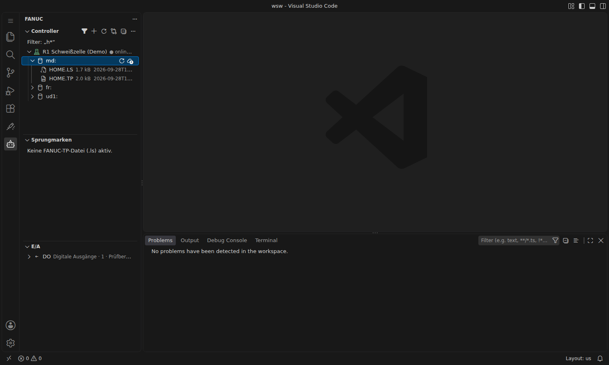
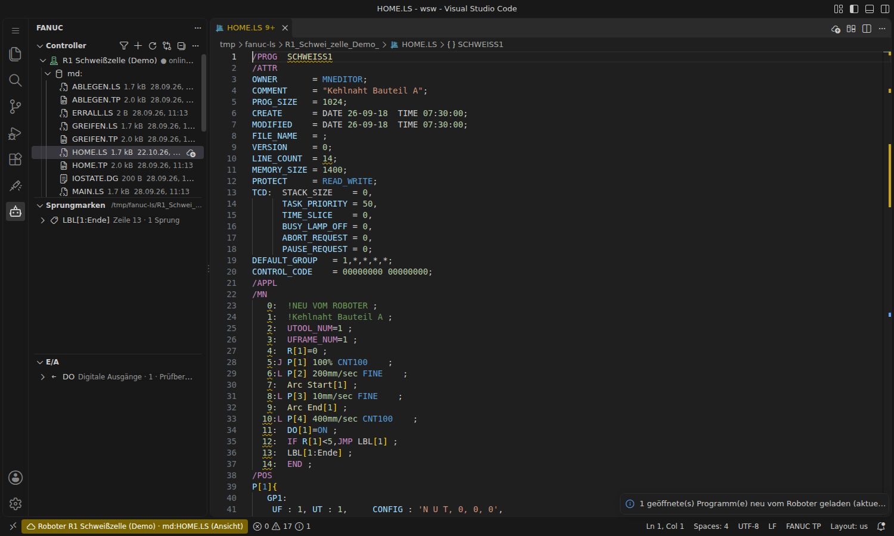
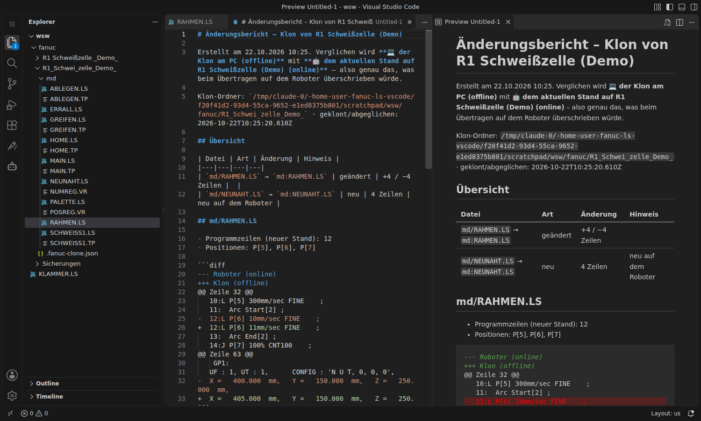

# Controller und FTP

Über das **Roboter-Symbol** in der Activity Bar öffnet sich die Controller-Ansicht mit dem Baum **Controller → Gerät (`md:`, `fr:`, `ud1:` …) → Dateien**.


> Die Screenshots auf dieser Seite wurden mit einem simulierten FTP-Server aufgenommen, nicht mit einer echten Steuerung. Die Dateiliste einer echten Steuerung sieht entsprechend aus, ist aber meist deutlich länger.

## Controller einrichten

1. In der Controller-Ansicht auf **+** (*Controller hinzufügen*) klicken.
2. Nacheinander eingeben: Anzeigename, IP-Adresse, FTP-Port (Standard 21), Benutzer (meist `anonymous`) und die Geräte (kommagetrennt, z. B. `md:,fr:,ud1:`).
3. Zum Schluss wird ein Passwort abgefragt. Leer lassen, wenn die Steuerung keines braucht. Ein eingegebenes Passwort wird verschlüsselt im **SecretStorage** von VS Code abgelegt, nicht in `settings.json`. Ändern lässt es sich später per Rechtsklick → **Passwort hinterlegen**.

Die Controller stehen danach in `fanucLs.controllers` und lassen sich auch direkt in `settings.json` pflegen:

```jsonc
"fanucLs.controllers": [
  { "name": "R1 Schweißzelle", "host": "192.168.0.10", "port": 21,
    "user": "anonymous", "devices": ["md:", "fr:", "ud1:"] }
]
```

Rechtsklick auf einen Controller: **Controller bearbeiten**, **Passwort hinterlegen**, **Controller entfernen**.

## Online-Status

Hinter jedem Controller steht, ob er erreichbar ist: **● online** (grünes Symbol) oder **○ nicht erreichbar** (rotes Symbol, Fehler im Tooltip). Ohne Angabe ist der Status noch unbekannt.

- Jede FTP-Aktion aktualisiert den Status.
- Solange die Controller-Ansicht oder die Schweißer-Startseite sichtbar ist, wird zusätzlich regelmäßig kurz angefragt (Standard alle 60 s, `fanucLs.ftp.statusInterval`, `0` = aus).
- Die Schweißer-Startseite zeigt den Status als 🟢/🔴/⚪ vor dem Roboternamen.

## Filtern und Suchen



Der **Trichter** in der Titelleiste der Controller-Ansicht filtert die Dateien:

1. Dateitypen anhaken (TP-Programme, KAREL, Variablen/System, E/A-Konfiguration, Listen/Diagnose, Andere). Nichts angehakt heißt alle Typen.
2. Optional Text eingeben: Der Name enthält den Text (`HOME`), oder ein Muster mit Platzhaltern (`H*.LS`, `?AIN*`).

Über der Liste steht der aktive Filter. Der gefüllte Trichter hebt ihn wieder auf. Ordner bleiben sichtbar; die Dateilisten werden dabei nicht neu vom Roboter geladen. Ebenfalls möglich: in der Ansicht einfach lostippen (Suche von VS Code in aufgeklappten Einträgen).

## Online oder offline?

Woher die geöffnete Datei stammt, zeigt die **Statusleiste** unten links:

| Anzeige | Bedeutung |
|---|---|
| ☁️ **Roboter R1 · md:HOME.LS (Ansicht)** (orange) | Vom Roboter geöffnet (Klick im Controller-Baum). Temporäre Ansicht; „Aktualisieren“ lädt sie neu. Änderungen landen erst mit *Hochladen* auf dem Roboter. |
| ☁️ **Stand auf dem Roboter (Vergleich)** | Linke Seite eines Vergleichs, frisch vom Roboter geladen. |
| 🖥️ **Klon von R1 (offline)** | Datei im Klon-Ordner am PC. |
| 🖥️ **PC-Kopie von R1 (offline)** | Heruntergeladene Datei am PC, Herkunft bekannt. |
| 🖥️ **PC (offline)** | Datei am PC ohne bekannte Herkunft. |



Auch der **Vergleich** nennt beide Seiten: `HOME.LS: 🤖 Roboter R1 (online, jetzt) ↔ 💻 Klon von R1 (offline)`. Links steht immer der aktuelle Stand auf dem Roboter, rechts die Datei am PC.

**Aktualisieren** (Pfeil in der Titelleiste) lädt die Dateilisten neu und dazu alle **vom Roboter angesehenen, unveränderten** Programme, z. B. für einen aktuellen E/A-Status. Arbeitskopien am PC und Dateien mit ungespeicherten Änderungen werden nicht angefasst.

## Dateien übertragen


| Aktion | Wo | Wirkung |
|---|---|---|
| Öffnen | Klick auf eine Datei | lädt in ein temporäres Verzeichnis und öffnet im Editor |
| Herunterladen | Wolken-Symbol an der Datei | legt die Datei im Workspace ab (Standard: Ordner `fanuc/`) |
| Ganzes Gerät sichern | Rechtsklick auf Gerät/Ordner | lädt alle Dateien eines Geräts herunter, praktisch als Schnellsicherung vor Änderungen |
| Datei hierher laden | Wolken-Symbol am Gerät | lädt eine lokale Datei auf dieses Gerät |
| Aktuelle Datei hochladen | Wolken-Button in der Editor-Titelleiste, Rechtsklick im Editor oder Explorer | lädt die offene `.ls`-Datei auf die Steuerung |
| Auf Controller löschen | Rechtsklick auf Datei | löscht nach Rückfrage |
| Mit Controller vergleichen | Diff-Button in der Editor-Titelleiste, Rechtsklick im Editor oder Explorer | zeigt die Unterschiede zwischen lokaler Datei und Steuerung im Diff-Editor |
| Mit lokaler Datei vergleichen | Rechtsklick auf eine Datei in der Controller-Ansicht | sucht die lokale Kopie (Herkunft, gleichnamige Datei im Workspace oder Auswahl) und zeigt die Unterschiede |

Details:
- Die **Herkunft** heruntergeladener Dateien wird gemerkt. Beim Hochladen wird der ursprüngliche Pfad als Ziel vorgeschlagen.
- Beim **Vergleichen** wird die Datei der Steuerung in ein temporäres Verzeichnis geladen und links angezeigt, die lokale Datei rechts. Sind beide gleich (Zeilenenden werden ignoriert), erscheint nur eine Meldung.
- **Vor dem Upload** läuft die Syntaxprüfung (`fanucLs.ftp.validateBeforeUpload`). Bei Fehlern kommt eine Rückfrage. Vor dem Überschreiben wird ebenfalls nachgefragt (`fanucLs.ftp.confirmUpload`).
- **Diagnose- und Berichtsdateien** (`*.DG`, `ERRALL.LS`, `LOGBOOK.LS`, `IOSTATE.DG` …) erzeugt die Steuerung selbst. Sie lassen sich lesen, aber nicht hochladen; die Extension erklärt das, statt einen FTP-Fehler zu zeigen. Lehnt die Steuerung einen Upload ab (FTP 550–553), nennt die Meldung die typischen Gründe.
- Pro Steuerung wird **nur eine FTP-Verbindung gleichzeitig** geöffnet, weil FANUC-Steuerungen nur sehr wenige Sitzungen zulassen.

## Controller klonen

Mit einem Klon arbeitet man wie mit einer lokalen Kopie der Steuerung: alles herunterladen, in Ruhe bearbeiten, Änderungen prüfen und nur das Geänderte zurückspielen.

1. **Klonen:** Rechtsklick auf den Controller → **Controller klonen / Klon aktualisieren**, dann die Geräte wählen (Standard: `md:`). Die Dateien landen im Download-Ordner unter `<Controllername>/<Gerät>/…`, z. B. `fanuc/R1_Schweisszelle/md/SCHWEISS1.LS`. Welche Dateitypen geladen werden, legt `fanucLs.clone.fileTypes` fest (Standard: `ls`, `tp`, `vr`, `pc`, `dt`).
2. **Bearbeiten:** ganz normal im Editor.
3. **Änderungen anzeigen:** **FANUC: Klon: Änderungen anzeigen** (auch über den Button in der Controller-Ansicht oder per Rechtsklick auf den Klon-Ordner). Die Liste zeigt geänderte, neue und lokal gelöschte Dateien. Ein Klick auf eine geänderte Datei öffnet den Vergleich mit der Steuerung.
4. **Bericht (optional):** **FANUC: Klon: Änderungsbericht erstellen**, auch im Dialog *Änderungen anzeigen* und vor dem Übertragen (*Erst Bericht anzeigen*). Der Bericht vergleicht jede geänderte Datei mit dem **aktuellen Stand auf dem Roboter**, also genau mit dem, was beim Übertragen überschrieben würde. Er enthält eine Übersicht (geändert/neu/gelöscht, Zeilen +/−, Konflikte), bei TP-Programmen die betroffenen Programmzeilen, Positionen und Kopfangaben und die Änderungen als Diff. Er öffnet sich als Markdown mit Vorschau und lässt sich speichern oder ausdrucken.
5. **Übertragen:** **FANUC: Klon: Änderungen auf Controller übertragen**. Die Dateien lassen sich einzeln abwählen. Vor dem Upload laufen die Syntaxprüfung und eine Sicherheitsabfrage.

Zum Schutz vor verlorenen Änderungen:
- Vor jedem Upload wird geprüft, ob die Datei **auf der Steuerung seit dem Klonen geändert** wurde, etwa am Teach Pendant. Solche Dateien werden nicht überschrieben, sondern als Konflikt gemeldet und lassen sich direkt vergleichen.
- **Klon aktualisieren** (erneut klonen) lädt den aktuellen Stand der Steuerung, überschreibt aber keine lokal geänderten Dateien.
- Lokal gelöschte Dateien werden **nicht** auf der Steuerung gelöscht.



Der Stand des letzten Abgleichs steht in `.fanuc-clone.json` im Klon-Ordner (Remote-Pfad und Prüfsumme je Datei). Die Datei gehört zum Klon und sollte nicht gelöscht werden. Wer den Klon mit Git versioniert, kann sie mit einchecken.

## Fehlersuche

- `fanucLs.ftp.verbose` einschalten und **FANUC: FTP-Protokoll anzeigen** aufrufen. Dort steht die komplette FTP-Kommunikation.
- Timeout erhöhen: `fanucLs.ftp.timeout` (Standard 8000 ms).
- Hängt die Verbindung: auf der Steuerung unter `MENU → SETUP → Host Comm → FTP` den FTP-Server neu starten.
- Weitere Hinweise unter [[Praxishinweise]].

