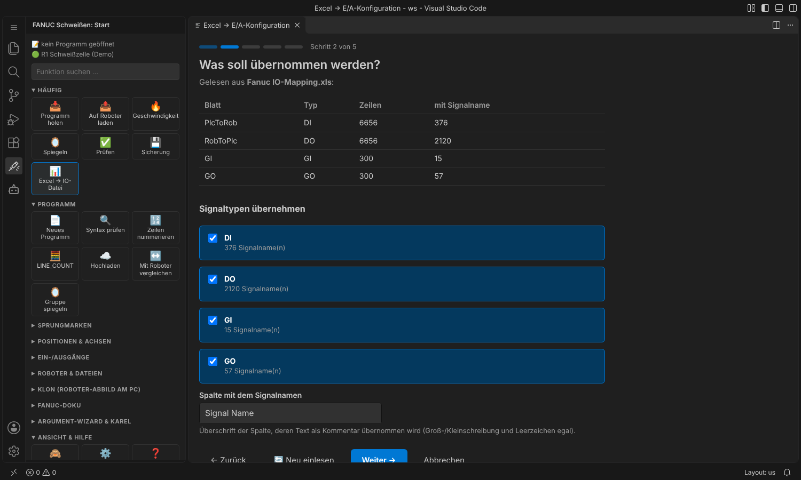
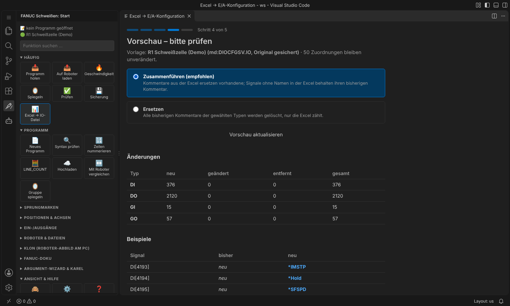
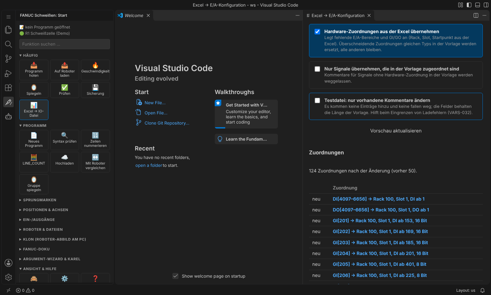
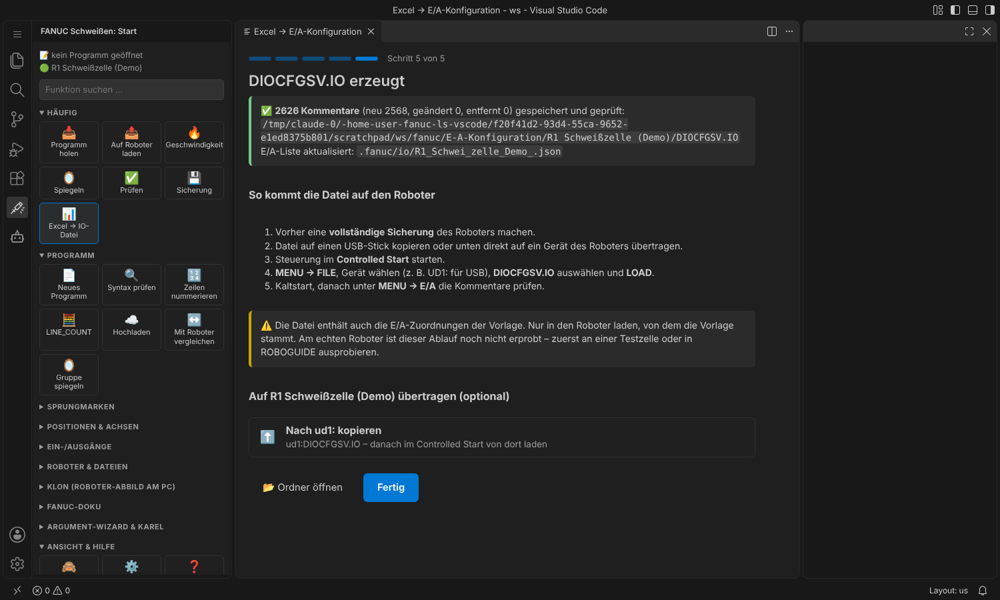
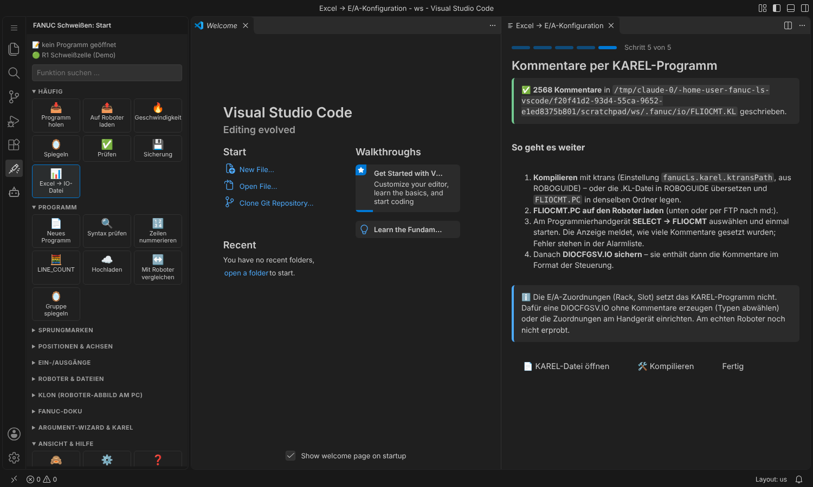
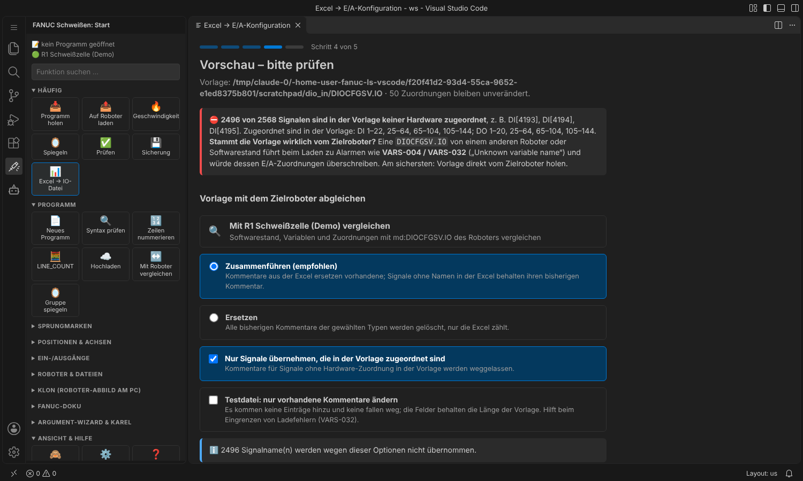

# Ein- und Ausgänge (E/A)

Die Extension sammelt Kommentare zu den Signalen (`DI`, `DO`, `RI`, `RO`, `GI`, `GO`, `AI`, `AO`, `UI`, `UO`, `SI`, `SO`, `F`, `M` …). Sie zeigt sie im Editor an und nutzt sie bei der Syntaxprüfung.


## Woher die Kommentare kommen

1. **Aus den Programmen im Workspace:** Referenzen mit Kommentar wie `DO[12:Greifer zu]` oder `DO[6338:ON :PrePosPickupDisk]` werden automatisch eingelesen.
2. **Vom Controller:** In der Ansicht **E/A** auf das Wolken-Symbol klicken (oder Rechtsklick auf einen Controller → **E/A-Liste vom Controller importieren**) und eine Datei wählen, empfohlen `md:IOSTATE.DG`. Die Extension liest daraus Typ, Nummer und Kommentar. **Der aktuelle Signalzustand (ON/OFF, Werte) wird nicht übernommen.**
3. **Aus einer CSV-Datei:** Datei-Symbol in der Ansicht E/A. Format je Zeile `Typ;Nummer;Kommentar` (auch mit `,` oder Tab getrennt, oder `DO[12];Kommentar`); eine Kopfzeile wird übersprungen.

Importierte Listen liegen als JSON unter `.fanuc/io/<Controller>.json` im Workspace und können mit eingecheckt werden. Über `…` → **E/A-Liste als CSV exportieren** lässt sich alles gesammelt, z. B. für Excel, ausgeben.

## Im Editor

- **Hover** über einem Signal zeigt Typ, Kommentar, Quelle und ggf. den im Text gespeicherten Status.
- **Vervollständigung** nach `DO[` schlägt die bekannten Nummern mit Kommentar vor; die Suche findet auch über den Kommentar (z. B. `DO[greif`).
- Ein Klick auf ein Signal in der Ansicht **E/A** sucht alle Verwendungen in den Programmen.

## Status ausblenden

Vom Controller exportierte Programme enthalten manchmal den Signalzustand zum Zeitpunkt des Exports: `WAIT DO[6338:ON :PrePosPickupDisk]=ON`. Das `ON :` ist dabei **nicht** der aktuelle Zustand und verwirrt beim Lesen.

- Standardmäßig wird der Status im Editor **ausgeblendet** (angedeutet durch einen Punkt `·`). In der Zeile mit dem Cursor ist der echte Text sichtbar. Die Datei bleibt unverändert.
- Umschalten über das Augen-Symbol in der Ansicht E/A oder die Einstellung `fanucLs.io.hideStatus`.
- Dauerhaft entfernen: Rechtsklick im Editor → **FANUC: Gespeicherten E/A-Status aus der Datei entfernen**. Aus `DO[6338:ON :PrePosPickupDisk]` wird `DO[6338:PrePosPickupDisk]`.

## Suchen

Der **Trichter** in der Ansicht E/A filtert nach Nummer oder Kommentar, z. B. `Greifer` oder `DO[12`. Passende Typen werden aufgeklappt; der gefüllte Trichter hebt den Filter auf.

## Signal-Excel in die E/A-Konfiguration übernehmen

Die Signalnamen aus der Signal-Excel (z. B. **Fanuc IO-Mapping.xls** mit den Blättern *PlcToRob*, *RobToPlc*, *GI*, *GO*) lassen sich direkt in die E/A-Konfiguration des Roboters schreiben, also in die Datei `DIOCFGSV.IO`. Excel muss dafür nicht installiert sein; gelesen werden `.xls` (Excel 97–2003) und `.xlsx`.

**Aufruf:** Kachel **Excel → IO-Datei** auf der Schweißer-Startseite (Bereich *Häufig*), in der Ansicht E/A über `…` oder mit **FANUC: Signal-Excel in E/A-Konfiguration (DIOCFGSV.IO) umwandeln**.

1. **Excel wählen.** Die zuletzt verwendete Datei wird vorgeschlagen.
2. **Prüfen, was übernommen wird.** Je Blatt stehen Signaltyp, Zeilen und die Anzahl der Signalnamen. Signaltypen lassen sich abwählen. Gelesen werden Blätter, deren erste Kopfzelle der Signaltyp ist (DI, DO, GI, GO, SI, SO, UI, UO, AI, AO, WI, WO …); der Kommentar kommt aus der Spalte **Signal Name** (anpassbar). Blätter mit Flags (`F`) werden übersprungen, weil Flag-Kommentare nicht in `DIOCFGSV.IO` stehen.
3. **Vorlage wählen:** die aktuelle `DIOCFGSV.IO` **des Zielroboters**, entweder direkt vom Roboter (`md:DIOCFGSV.IO`; das Original wird dabei unter `fanuc/Sicherungen/<Roboter>/E-A-Konfiguration/` gesichert) oder aus einem Backup.
4. **Vorschau:** *Zusammenführen* (Standard: Namen aus der Excel ersetzen vorhandene Kommentare, Signale ohne Namen behalten ihren Kommentar) oder *Ersetzen* (alle Kommentare der gewählten Typen neu). Die Tabelle zeigt je Typ neue, geänderte und entfernte Kommentare und Beispiele; zu lange Namen werden aufgelistet. Optional werden die Namen auch in die E/A-Liste dieser Arbeitsumgebung übernommen, dann zeigen Hover und Vervollständigung sie sofort.
5. **Speichern** und laden: Die Abschlussseite beschreibt, wie die Datei auf den Roboter kommt, und kann sie direkt auf einen Wechselspeicher des Roboters kopieren (z. B. `UD1:`).





**Hardware-Zuordnungen aus der Excel** (Option in der Vorschau, standardmäßig an): Fehlende E/A und Gruppen-E/A werden in der Datei angelegt.

- **DI/DO** (Blätter *PlcToRob*, *RobToPlc*): Spalten *Rack*, *Slot*, *StartPt*. Aufeinanderfolgende Signale mit fortlaufendem Startpunkt werden zu einem Bereich zusammengefasst, z. B. `DI[4097–6656] → Rack 100, Slot 1, ab 1`. Zeilen ohne vollständige Angabe (z. B. Rack ohne Slot) werden übersprungen und gezählt.
- **GI/GO** (Blätter *GI*, *GO*): je Zeile *Rack*, *Slot*, *Start Pt*, *Num Pts*. **Unbestätigt:** Die Ablage in der Datei (Startnummer, Anzahl Bits, physischer Typ DI/DO) ist aus dem Aufbau der DI/DO-Zuordnungen abgeleitet. Nach dem Laden unter **MENU → E/A → Gruppe → KONFIG** prüfen.
- Zuordnungen der Vorlage, die sich mit einer neuen gleichen Typs überschneiden, werden ersetzt; alle anderen bleiben (UOP, SOP, Analog, Schweiß-E/A …). Die Vorschau listet neue und ersetzte Zuordnungen.
- Die Zuordnungen müssen zur Hardware-Konfiguration des Roboters passen (z. B. PROFINET-Modulgröße auf Rack 100, Slot 1). Die wird hier nicht geändert.



**Was sonst gleich bleibt:** Modi, analoge Einstellungen und Gerätedaten werden unverändert aus der Vorlage übernommen und nach dem Schreiben gegengeprüft. Deshalb muss die Vorlage vom Roboter stammen, in den die Datei geladen wird.

**Regeln für die Namen:** Umlaute werden umgeschrieben (`ä` → `ae`, `ß` → `ss`, `°` → `deg`, `µ` → `u`), andere Sonderzeichen werden zu `?`. Mehr als 24 Zeichen werden gekürzt (FANUC speichert 16 + 8 Zeichen).

**Laden am Roboter:** vorher vollständig sichern, Datei auf USB-Stick (oder per Assistent nach `UD1:`), Controlled Start, **MENU → FILE**, Gerät wählen, `DIOCFGSV.IO` → **LOAD**, Kaltstart, Kommentare unter **MENU → E/A** prüfen.

> Die Dateierzeugung ist byte-genau mit dem ursprünglichen Python-Konverter abgeglichen. **Das Laden an einem echten Roboter ist noch nicht erprobt** – bitte zuerst an einer Testzelle oder in ROBOGUIDE ausprobieren.



### Ladefehler VARS-004 / VARS-032

| Alarm | Text laut FANUC | Bedeutung hier |
|---|---|---|
| **VARS-032** | *Variable size too big* – die Variable ist größer als 65 535 Byte | Zu viele Kommentare: Jeder Kommentar belegt 20 Byte im Feld `NAME_NAME` (und `NAME_NAME2`), also passen höchstens **3 276** in eine `DIOCFGSV.IO`. |
| **VARS-004** | *%s memory not updated* – die Variable existiert im Speicher, die Daten konnten nicht geladen werden | Folgefehler: Die zu große bzw. unpassende Variable ersetzt den Stand im Speicher nicht. |

**Größengrenze im Assistenten:** Die Vorschau zeigt, wie viele Kommentare die Datei enthält und wie viele höchstens passen. Wird die Grenze überschritten, lässt sich keine Datei erzeugen. Abhilfe:

- Signaltypen abwählen (Schritt 2) oder *Vorhandene Kommentare für nicht zugeordnete Signale entfernen*.
- **Stattdessen per KAREL-Programm setzen:** Der Assistent erzeugt `.fanuc/io/FLIOCMT.KL` mit allen Kommentaren (KAREL-Built-in `SET_PORT_CMT`). Kompilieren (ktrans), `FLIOCMT.PC` auf den Roboter laden, am Handgerät einmal starten. Dafür gilt die Größengrenze der Datei nicht. Danach die `DIOCFGSV.IO` sichern. Die Zuordnungen (Rack/Slot) setzt das Programm nicht; dafür eine `DIOCFGSV.IO` ohne Kommentare erzeugen oder am Handgerät einrichten. *Noch nicht am Roboter erprobt.*



Weitere mögliche Ursache: **Die Vorlage stammt nicht vom Zielroboter** (anderer Roboter oder Softwarestand). Dann enthält die Datei Variablen oder Feldlängen, die der Roboter nicht kennt, und sie würde außerdem seine E/A-Zuordnungen überschreiben.

Der Assistent hilft dabei:

- **Zuordnungsprüfung:** Sind Signale aus der Excel in der Vorlage keiner Hardware zugeordnet (z. B. Excel `DI[4193…]` auf Rack 89, Vorlage nur `DI[1–144]` auf Rack 0), erscheint eine deutliche Warnung. Standardmäßig werden dann nur zugeordnete Signale übernommen.
- **Mit dem Zielroboter vergleichen:** Bei einer Vorlage aus einer Sicherung lässt sie sich in der Vorschau mit `md:DIOCFGSV.IO` eines Roboters vergleichen (Softwarestand, Variablen, Datentypen, Zuordnungen). Vor dem Kopieren auf den Roboter wird automatisch verglichen; passt die Datei nicht, wird nicht kopiert.
- **Testdatei:** Mit *nur vorhandene Kommentare ändern* behalten alle Felder die Länge der Vorlage. Lädt diese Datei fehlerfrei, die vollständige aber nicht, liegt es an der Anzahl der Einträge.
- **FANUC: DIOCFGSV.IO prüfen / vergleichen** (Kachel *IO-Datei prüfen*): Bericht zu einer Datei – Softwarestand, Variablen mit Typ und Länge, Zuordnungen, Kommentare je Typ – und auf Wunsch der Vergleich mit einer zweiten Datei oder der auf einem Roboter.



Checkliste: Vorlage direkt vom Zielroboter holen, im **Controlled Start** laden, bei weiteren Alarmen den Text mit **DETAIL** aus der Alarmhistorie notieren (enthält meist den Variablennamen) und den Prüfbericht beilegen.

**Umgekehrt:** Die Kommentare einer vorhandenen `DIOCFGSV.IO` lassen sich in die E/A-Liste der Extension übernehmen: beim Import vom Controller `md:DIOCFGSV.IO` wählen oder über den CSV-Import eine `.IO`-Datei öffnen.

## E/A-Kommentare auf den Roboter schreiben

Eine geänderte E/A-Liste lässt sich nicht einfach hochladen: `IOSTATE.DG` ist eine Diagnose-Ausgabe der Steuerung (nur lesbar), die eigentliche E/A-Konfiguration (`DIOCFGSV.IO`) ist binär und nur beim Kaltstart ladbar. Der dokumentierte Weg führt über das KAREL-Built-in `SET_PORT_CMT`:

1. Kommentare in der E/A-Liste pflegen, am einfachsten als CSV (exportieren, in Excel bearbeiten, wieder importieren).
2. In der Ansicht E/A `…` → **E/A-Kommentare auf Roboter übertragen (KAREL)**, Typen und Roboter wählen.
3. Die Extension erzeugt `.fanuc/io/FLIOCMT.KL`. Mit eingerichtetem ktrans (`fanucLs.karel.ktransPath`, aus ROBOGUIDE) → **Kompilieren**, sonst die Datei in ROBOGUIDE kompilieren und `FLIOCMT.PC` in denselben Ordner legen.
4. **FLIOCMT.PC hochladen**, dann am Programmierhandgerät **SELECT → FLIOCMT** auswählen und einmal starten. Das Programm meldet, wie viele Kommentare gesetzt wurden; Fehler stehen in der Alarmliste. Danach kann es gelöscht werden.

Hinweise: Umlaute werden umgeschrieben (`ä` → `ae`), Kommentare auf 24 Zeichen gekürzt (ältere Steuerungen zeigen ggf. nur 16). Unterstützt werden DI, DO, RI, RO, GI, GO, AI, AO, UI, UO, SI, SO, WI, WO und Flags, Merker (`M`) nicht. **Am echten Roboter noch nicht erprobt – bitte zuerst an einer Testzelle oder in ROBOGUIDE ausprobieren.**

## Gültige Bereiche

**Wozu?** Die Bereiche legen nur fest, welche Nummern die **Syntaxprüfung** ohne Warnung akzeptiert, damit Tippfehler wie `DO[1200]` statt `DO[120]` auffallen. Am Roboter ändern sie nichts. Signale aus einer **importierten E/A-Liste gelten immer als gültig**, auch außerhalb des Bereichs; deshalb gibt es z. B. bei `DO[6338]` keine Warnung, wenn das Signal in der Liste steht. Den aktuellen Prüfbereich je Typ zeigt die Ansicht E/A hinter der Typbezeichnung.

Die Syntaxprüfung warnt bei Signalnummern außerhalb der konfigurierten Bereiche (`fanucLs.validation.limits`). Standard ist `1-512` für `DI`/`DO`. Größere Anlagen nutzen oft höhere Nummern, etwa `DO[6338]`. Dafür gibt es drei Wege:

- **E/A-Liste importieren:** Alle Signale aus einer importierten Liste gelten automatisch als gültig.
- **Quick Fix** an der Warnung (`Strg+.`) → **Gültige Bereiche für DO bearbeiten …**, oder das Stift-Symbol am Typ in der Ansicht E/A. Schlägt den passenden Tausenderblock vor, z. B. `1-512, 6001-7000`. Gespeichert wird in den **Benutzereinstellungen**, der Bereich gilt also dauerhaft für alle Ordner und auch für Programme, die direkt vom Roboter geöffnet werden.
- **Von Hand** in den Einstellungen, mehrere Bereiche als Text:

```jsonc
"fanucLs.validation.limits": {
  "DI": "1-512, 4001-5000",
  "DO": "1-512, 6001-7000",
  "R": 200
}
```

Eine Zahl `n` bedeutet `1..n`, `0` schaltet die Prüfung für den Typ ab.
