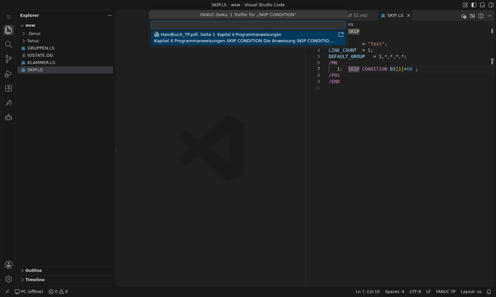
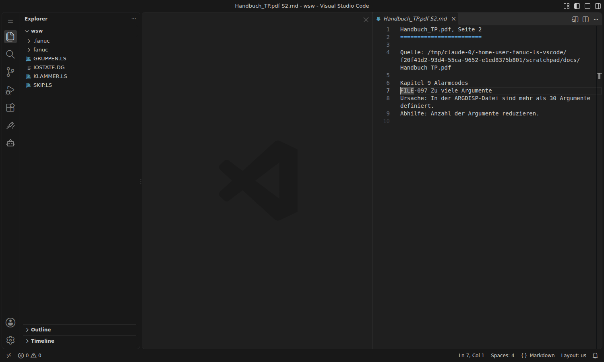

# FANUC-Doku

Die Extension durchsucht **eure eigenen FANUC-Handbücher**: im Editor und als Werkzeug für GitHub Copilot. Die Handbücher sind urheberrechtlich geschützt und werden deshalb nicht mitgeliefert. Sie bleiben in einem lokalen Ordner, den ihr festlegt.



## Einrichten

1. Handbücher in einen Ordner legen, gern mit Unterordnern. Unterstützt werden:
   - **PDF mit Textebene** (die meisten digitalen FANUC-Handbücher)
   - **Text** (`.txt`) und **Markdown** (`.md`), z. B. eigene Notizen zur Zelle oder Auszüge
2. **FANUC: Doku-Ordner festlegen** (Befehlspalette oder Kachel *Doku-Ordner* auf der Schweißer-Startseite) und den Ordner oder eine einzelne Datei wählen. Das setzt die Einstellung `fanucLs.docs.folder`.
3. Die Extension liest die Dateien einmal ein (Fortschritt unten in der Statusleiste) und merkt sich das Ergebnis. Danach werden nur neue oder geänderte Dateien gelesen; neue Dateien im Ordner werden automatisch erkannt.

`fanucLs.docs.folder` kann auch von Hand gesetzt werden, z. B. für ein ganzes Team auf ein Netzlaufwerk oder relativ zum Arbeitsordner:

```jsonc
"fanucLs.docs.folder": "${workspaceFolder}/doku"      // im Projekt
"fanucLs.docs.folder": "~/FANUC/Handbuecher"          // im Benutzerordner
"fanucLs.docs.folder": "\\\\server\\robotik\\FANUC"   // Netzlaufwerk (Windows)
```

**Gescannte PDFs** (nur Bild, kein Text) lassen sich nicht durchsuchen. Die Extension meldet sie nach dem Einlesen (*Ohne Text (gescannt)*). Abhilfe: das PDF vorher mit Texterkennung (OCR) umwandeln, z. B. mit Adobe Acrobat oder dem kostenlosen `ocrmypdf`.

## Suchen und nachschlagen

| Befehl | Wirkung |
|---|---|
| **FANUC: In FANUC-Doku suchen** | Suchbegriff eingeben, Trefferliste mit Datei, Seite und Auszug |
| **FANUC: In FANUC-Doku nachschlagen** | Rechtsklick im Programm: sucht den Befehl unter dem Cursor (auch mehrteilig wie `SKIP CONDITION`) oder den markierten Text |
| **FANUC: Doku neu einlesen** | alle Dateien neu lesen und das Ergebnis melden |

- Ein Klick auf einen Treffer zeigt die **Seite als Text** neben dem Programm und springt zur Fundstelle. Markdown- und Textdateien öffnen sich direkt an der Stelle.
- Das Symbol ↗ rechts am Treffer öffnet die **Originaldatei**, z. B. das PDF im PDF-Betrachter.
- Die Suche ignoriert Groß-/Kleinschreibung und Umlaute (`fuer` findet `für`). Codes wie `FILE-097` oder `SRVO-062` bleiben zusammen. Seltene Begriffe und Treffer in Überschriften stehen weiter oben.



## Mit GitHub Copilot

Die Extension stellt Copilot das Werkzeug **FANUC-Doku durchsuchen** (`fanuc_docs_search`) zur Verfügung (VS Code ≥ 1.95, Copilot im Agent-Modus):

- **Automatisch:** Bei Fragen zu Befehlen, Optionen, Systemvariablen oder Alarmcodes sucht Copilot zuerst in den Handbüchern und nennt Datei und Seite. Der mitgelieferte [[Copilot-Skill]] weist Copilot darauf hin.
- **Gezielt:** Im Chat `#fanucDocs` angeben, z. B. *„Was bedeutet SRVO-062 und wie behebe ich ihn? #fanucDocs“*.

Copilot bekommt dabei nur die gefundenen Abschnitte (höchstens 10), nicht die ganzen Handbücher. Ist kein Ordner eingerichtet, sagt das Werkzeug das Copilot, und Copilot weist darauf hin.
